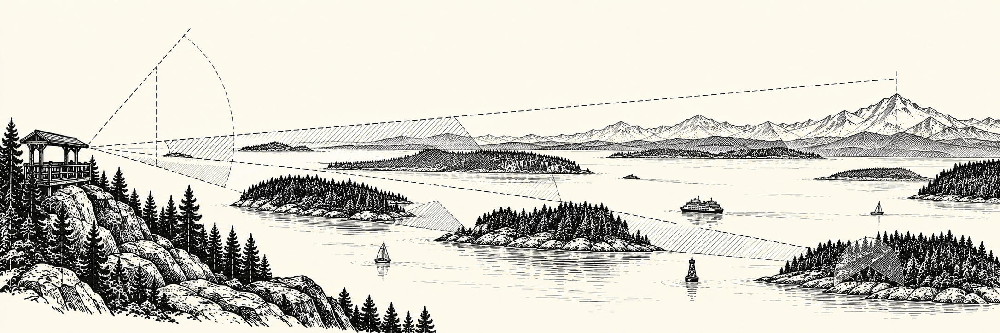
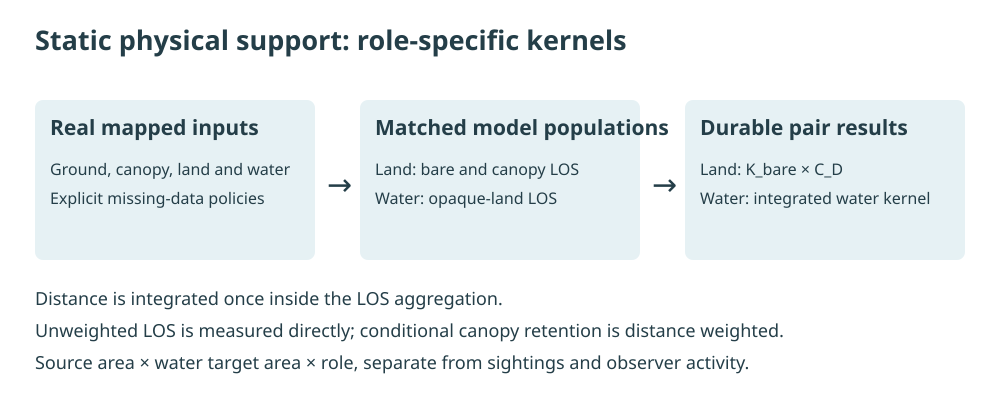

# Viewshed Toolkit



A Python 3.11+ package for reproducible terrain, canopy, and distance visibility modeling.
It produces provenance-aware H3 tables at one unique `source_h3 × target_h3` pair per source
role, with each component retained for inspection.

These are **static physical viewability** products. They do not estimate observer effort,
public access, reporting probability, animal detection probability, occurrence, or abundance.

Explore the [documentation site](https://marinecast.github.io/toolkit-viewshed/), starting with
the [quick start](docs/getting-started/quick-start.md), [product guide](docs/products/index.md), or
[San Juan guided example](docs/examples.md).

## Methodology

The toolkit builds a deterministic universe of H3 source–target pairs, samples viewpoints within
each source cell, and evaluates line of sight to water targets. Land sources use bare-earth DEM and
matched DEM+CHM surfaces to separate terrain support from conditional canopy obstruction. Water
sources use the configured opaque-land policy. The line-of-sight kernel applies range attenuation,
and the resulting pair weights can be aggregated into maps of static viewing support.



*Conceptual overview only: the illustrated target area does not supply animal activity to the
model. Outputs describe static physical viewability, and aggregate sums do not represent observer
effort or detection probability.*

See the [methodology guide](docs/methodology.md) for the staged calculation and interpretation
boundary, and the [scientific methodology](docs/scientific-methodology.md) for the exact formulas,
missingness rules, and distance treatment.

## Install

Use an isolated environment with binary-compatible GDAL and Rasterio, then:

```bash
python -m pip install -e '.[dev,analysis]'
viewshed-toolkit --help
```

Install `.[acquisition]` to use the USGS py3dep downloader. The package itself remains Python;
The small end-to-end test requires GDAL
Python bindings. `.github/environment.yml` describes the geospatial CI environment.

## A first result without downloads

```bash
python examples/offline_distance.py --output work/my-first-distance
viewshed-toolkit doctor --config work/my-first-distance/config.yaml --workflow distance
```

This uses deliberately synthetic geometry and the production distance APIs, with formula and
artifact validation. It does not run LOS or represent observed coastline. Choose a new directory;
existing directories are never overwritten. Follow the [quick start](docs/getting-started/quick-start.md)
for expected outputs and the next step to real San Juan data.

## Configure a region

For a small runnable example, start with the [San Juan Islands demo](docs/san-juan-demo.md).
It includes a real-data configuration, a production-pipeline runner, an interactive map and
documentation figures, with explicit source coverage and interpretation limits.

```bash
# Bounded real model; native geospatial environment required.
PYTHONPATH=src python scripts/run_san_juan_demo.py \
  --config configs/san_juan_demo.yaml --rebuild --model-only

# Export checked documentation derivatives from the validated results.
PYTHONPATH=src python scripts/build_documentation_examples.py \
  --config configs/san_juan_demo.yaml --output docs/assets/examples/san-juan
```

Reading the [committed guided example](docs/examples.md) needs no native environment. Model execution requires the `analysis` and `acquisition` extras and compatible GDAL. The runner defaults to model-only and prints the next export command; it does not write retired documentation assets.

Start with `configs/salish_sea.yaml`, or the configuration bundled in the wheel:

```python
from viewshed_toolkit import load_app_config
from viewshed_toolkit.resources import default_config_path

config = load_app_config(default_config_path())  # read-only
print(config.region.bbox_wgs84)
```

The Salish Sea config uses the single `model_area` definition in packaged `common.yaml`, matching
the OrcaCast SRKW domain. For another region, remove `area` and supply `region.bbox_wgs84` with
`min_lon`, `min_lat`, `max_lon`, and `max_lat`. Configure land/water geometry paths, provider
settings, H3 resolution, physical assumptions, and separate working/durable output directories.
Relative paths resolve through the existing project-root helpers; `VIEWSHED_TOOLKIT_ROOT` selects
an intentional alternate project root. See [configuration](docs/configuration.md).

## Run independent stages

The explicit component workflow supplements the existing paired production workflow:

| Contract | Established production workflow | Explicit component workflow |
|---|---|---|
| Main API | `run_viewshed` / `process` | `run_components` / `run_component_stage` |
| Durable outputs | Compact legacy final outputs | Separate `components/` namespace |
| Automatic cleanup | Validated scratch cleanup; reusable caches retained by default | None |
| Land/water promotion | Rollback-safe paired promotion | Per-role manifests; no combined atomic generation pointer |

```bash
# Inspect prerequisites and planned work without executing stages:
viewshed-toolkit build static --config configs/salish_sea.yaml --source-type land --run-id land-static --dry-run

viewshed-toolkit stage download-dem --config configs/salish_sea.yaml
viewshed-toolkit stage download-chm --config configs/salish_sea.yaml
viewshed-toolkit stage prepare-dem --config configs/salish_sea.yaml
viewshed-toolkit stage prepare-chm --config configs/salish_sea.yaml

# Build a selected product and its dependencies:
viewshed-toolkit build dem --config configs/salish_sea.yaml --run-id dem
viewshed-toolkit build chm --config configs/salish_sea.yaml --run-id chm
viewshed-toolkit build distance --config configs/salish_sea.yaml --run-id distance
viewshed-toolkit build static --config configs/salish_sea.yaml --source-type land --run-id land-static
viewshed-toolkit build all --config configs/salish_sea.yaml --source-type land --run-id land-maps
viewshed-toolkit build all --config configs/salish_sea.yaml --source-type water --run-id water
```

`build static` finishes and validates the selected role's static table without exporting maps;
`build all` also exports the factor maps. Water builds use geometry and the opaque-land model,
so their dependency plans omit DEM/CHM acquisition and preparation. `build distance` remains
raster-independent for both roles. When a land build needs both DEM and CHM weights, it shares
batch raster preparation while retaining the independent component outputs and stage commands.
See [pipeline stages](docs/pipelines.md) for the complete contract.

Start with `--dry-run` to inspect the planned stages, inputs, output roots, backend capabilities,
resource snapshot, and run-ID conflicts without downloading or writing products. It checks
readable metadata; existing caches remain unverified until the build validates them. Normal
configuration validation still checks configured shared-study identities. A ready plan is not
proof of provider availability, valid-data coverage, or a regional runtime estimate.

Distance can also be reused as a first-class product. Build the role-specific pair distances once,
then create any number of content-addressed attenuation profiles without geometry or rasters:

```bash
viewshed-toolkit build-pair-distances --config configs/salish_sea.yaml --source-type land
viewshed-toolkit build-distance-profile \
  --pair-distances data/processed/domain/human/viewshed/RES7/components/distance/land/pair_distances.parquet \
  --profile-id near --model exponential --exponential-lambda-km 5 --hard-cutoff-km 20
```

The exact output root follows `paths.final_output_dir`; each command prints its actual path. See
[distance products](docs/distance-products.md) for schemas, Python examples, validation, candidate
coverage, and cache identity.

`stage` runs exactly one operation and requires its upstream inputs. `build` resolves dependencies;
it can download regional data and run substantial computation. Geometry inputs must already exist.
Use a dedicated configuration/output directory for a new regional run. `--overwrite` rebuilds
selected products; unchanged stages validate fingerprints and checksums before reuse.
Legacy `process(..., resume=True)` requires a complete, matching manifest, current input
fingerprints, and valid output checksums. Old manifests or changed inputs fail closed: rebuild
affected stages explicitly with `overwrite=True`, then use a new run ID. `force=True` does not
bypass these checks or rebuild scientific stage caches.
See [cache recovery](docs/pipelines.md#caching-and-failures).

## What the components mean

- **DEM:** terrain LOS diagnostics plus the existing observer-to-water-pixel distance-integrated
  `weight_terrain` kernel. It runs without CHM.
- **CHM:** conditional additional canopy obstruction from matched DEM and DEM+CHM surfaces.
  It requires the DEM component, but never the centroid-distance artifact.
- **Distance:** configured logistic, exponential, or piecewise attenuation of pair centroid
  distances, independent of rasters.
- **Static:** `weight_terrain × weight_vegetation`. Distance is already integrated inside the
  terrain kernel; multiplying by the centroid-distance diagnostic again would change the science.

See [scientific methodology](docs/scientific-methodology.md) for formulas and missingness rules.

## Outputs

The explicit workflow writes under `<paths.final_output_dir>/components/`:

```text
inputs/{dem,chm}/         Source assets, download manifests, checksums
geometry/                Area and target-cell products
distance/{land,water}/   Raw pair distances and independently reusable profiles
weights/{land,water}/     dem_weights, chm_weights, distance_weights, static_weights
final/                   land_static_weights.parquet / water_static_weights.parquet
manifests/               Per-source run metrics and validation reports
maps/                    Static target-support HTML maps
```

Prepared DEM/CHM, source cells, pair lookup, and scratch partitions use the existing configured
paths. Component stages never clean these directories implicitly. The earlier
`run_viewshed`/`process` workflow still produces its original compact final contracts and retains
its paired promotion guarantees. Reusable caches are retained by default after success;
`run.cleanup_policy: compact` selects compact cleanup. Both protect configured source inputs.
See [API](docs/api.md), [pipelines](docs/pipelines.md), and the
[bounded workflow timing](docs/reports/workflow-runtime-2026-11-04.md).

## Columbia River to northern Vancouver Island

The November 5, 2026 [completed regional run](docs/reports/full-regional-run-2026-11-05.md)
produced validated land and water static weights and observation geometry for 13,461 native
R7 water targets. The four tables and producer metadata are available in the MarineCast
workspace under `Data/Viewshed`. The measured workflow took 3h 4m 9s with retained inputs.

The standalone regional case-study recipe uses `configs/salish_sea_case_study.yaml`. Its `case_study` section
creates `analysis/salish_sea`; all raster inputs, intermediate data, weights, aggregates, maps,
and run logs are stored under `data/salish_sea`. The HTML analysis report lives in the analysis
folder. This domain extends beyond the separate canonical OrcaCast model-area configuration.

```bash
PYTHONPATH=src python scripts/run_case_study.py --config configs/salish_sea_case_study.yaml
```

The command acquires data and performs the complete land and water calculation. It is a regional
run, not a quick smoke test. See [the case-study guide](docs/salish-sea-case-study.md) for outputs,
report packaging, and source limitations.

## Reproduce and validate

```bash
PYTHONPATH=src python -m pytest -q tests/pipeline/test_component_workflow.py
viewshed-toolkit validate-region --config configs/salish_sea.yaml --inputs-only
viewshed-toolkit validate-region --config configs/salish_sea.yaml
```

The CI fixture is synthetic coast, terrain, and canopy at Admiralty Inlet coordinates; it contains
multiple land/water H3 cells and needs no network. It also compares separated land execution
with the existing paired runner. It is not measured local elevation or a full regional rebuild.
The [Salish Sea guide](docs/salish-sea-case-study.md) records the regional data boundary.

## Development and design

```bash
PYTHONPATH=src python -m pytest -q
ruff check src tests
python scripts/check_components.py
python -m compileall -q src
```

The component code passes expanded Ruff, Black, and strict mypy gates. Existing unrelated
formatting/import-order debt remains outside those incremental gates.

- [Architecture](docs/architecture.md) · [Acquisition](docs/data-acquisition.md)
- [Performance](docs/performance.md)
- [Refactor validation and remaining boundaries](docs/reports/productionization.md)

Code is Apache-2.0 licensed. Source data and derived products retain their original terms and
are not redistributed with the package.

The [guided Examples page](docs/examples.md) explains the real San Juan model without coding.
For a local documentation preview, install `requirements-docs.txt`, run `python -m mkdocs serve`,
and open the Examples navigation item. The [reproduction guide](docs/documentation-examples.md)
separates model execution, scientific export and offline validation.

The `Publish documentation` GitHub Actions workflow validates and builds the site on relevant pull
requests and on pushes to `main`. Deploy the built site by running the workflow manually on
`main`. To enable hosting once, open repository
**Settings → Pages → Build and deployment → Source** and select **GitHub Actions**.
After the workflow is merged, it can also be run from **Actions → Publish documentation →
Run workflow**, selecting `main`. The site is hosted at
[marinecast.github.io/toolkit-viewshed](https://marinecast.github.io/toolkit-viewshed/).
The workflow uses the committed demo bundle and requires only documentation dependencies.

## Contribute and cite

See [CONTRIBUTING](CONTRIBUTING.md), the [change history](CHANGELOG.md), and
[CITATION.cff](CITATION.cff). Cite the exact commit or release used with the separate source-data
attributions. Software checks are not field validation; see the
[acceptance matrix](docs/development/acceptance.md).


Retained land-pilot comparison counts can be exported with
`viewshed_toolkit.export_comparison_maps(payload, output_directory)`. This produces distinct
target/source aggregates and a selected-source map, with actual-count arithmetic visibility,
unknown intervals and secondary exact-point diagnostics. See the
[API contract](docs/api.md#retained-sample-comparison-maps) and
[scientific definitions](docs/scientific-methodology.md#retained-sample-comparison-maps).

### Supported direct-ray transmission scenario

The demonstrated WorldCover/CHM method is now available as `viewshed-toolkit transmission` and
`viewshed_toolkit.run_transmission`. Select the explicit v2 method and a fresh provisioned-input
workspace. It retains partial-water coverage, uncertainty bounds and conditional factors; old
GDAL outputs retain their meaning. See [direct transmission](docs/direct-transmission.md) for
configuration, execution and regional qualification limits.

Provisioned explicit-v2 inputs can also use a persistent xarray tile workflow: plan and preprocess one
compressed current store, then run weights from read-only prepared tiles. See
[prepare-then-score commands and limits](docs/direct-transmission.md#persistent-xarray-tile-preparation-and-scoring).

Optional [shared-study selection](docs/api.md#explicit-coastal-shared-study) consumes pinned native
R7 target and separate observer-source memberships. It is independent of sibling checkouts and
retains the existing standalone configuration workflow.

The [2026-11-04 regional US/Canadian qualification and benchmark](docs/reports/regional-qualification-2026-11-04.md)
records retained regional DEM/canopy inputs, zero required height gaps, unchanged 30 m/R7 sampling,
and a 144-source paired benchmark. The conditional steady land-LOS estimate applies to that
benchmark. The completed-run report above records the later end-to-end measurement.

The [inland-water elevation correction](docs/reports/inland-water-elevation-2026-11-04.md)
preserves lake/river DEM heights and requires explicit marine evidence for sea-level assignment.
Its same-cohort paired rerun supersedes the previous timing and inland-water limitation.
