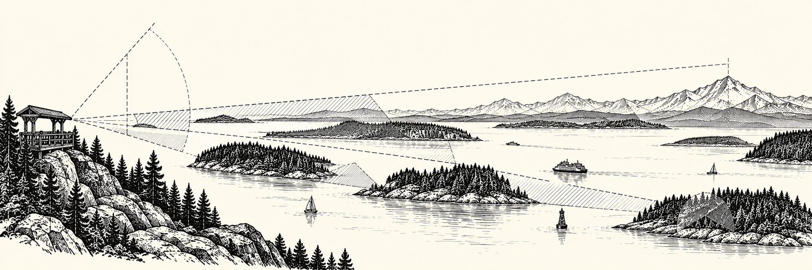

# Viewshed Toolkit

Understand the <strong>physical limits of a view</strong> from coastal land and open water.

Viewshed Toolkit models viewing support from **source areas** to **water target areas**. It uses
mapped land/water geometry, ground elevation, canopy where applicable, and explicit model
settings. The outputs are source–target tables with component scores, coverage states and
provenance.

A score describes **static physical viewability**. It is not animal presence, observer effort,
public access or the probability of seeing a whale. That distinction matters when using the
results to study observation bias or compare potential viewing locations.

[Read the visual walkthrough](examples.md){ .md-button .md-button--primary }
[How it works](understand/index.md){ .md-button }

## Start at Lime Kiln

Follow one source area on San Juan Island through five matching maps: study area, distance,
terrain, vegetation and combined support. A credited shoreline photograph connects the mapped
abstractions to the place. All results are already computed; no installation is needed.

**Recommended route:** [Lime Kiln walkthrough](examples.md) →
[small runnable example](getting-started/quick-start.md) → [read the outputs](products/index.md).

## Go straight to your task

| You want to… | Start here |
| --- | --- |
| Understand sightlines, trees, distance decay and practical uses | [How it works](understand/index.md) |
| Produce a first result with invented inputs and no downloads | [Install](getting-started/installation.md#offline-example), then [run the offline example](getting-started/quick-start.md) |
| Run the real San Juan model | [Native setup and model command](san-juan-demo.md) |
| Inspect real saved regional records using only Python | [Read the included excerpt](regional-viewshed-example.md#read-the-included-excerpt) |
| Use a delivered table in another project | [Outputs and interpretation](products/index.md) |
| Check an exact equation or setting | [Scientific contracts](scientific-methodology.md) · [Configuration](configuration.md) |

The Lime Kiln walkthrough uses the completed 30 m regional delivery. The separate detailed
sightline lesson and small model recipe retain the bounded 100 m San Juan demonstration. Recorded model results and software checks do not establish field accuracy.
