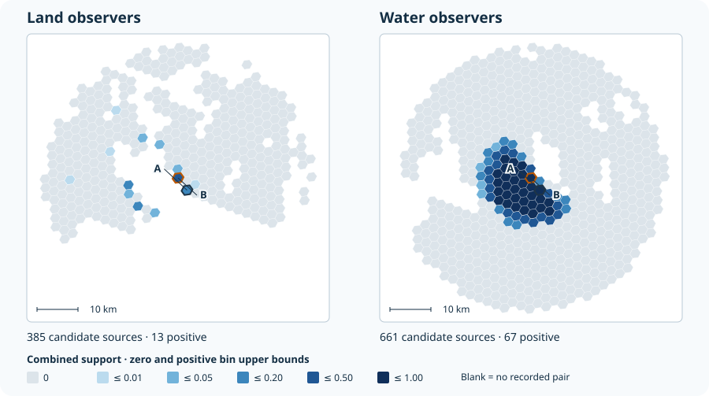

# Completed regional viewshed

The November 5, 2026 Vancouver Island–Columbia run calculated static viewing support from land
and water observer areas to **13,461 water target cells**. This example uses the validated
`regional_static_viewshed_v1` delivery in the MarineCast workspace's `Data/Viewshed` directory.
The [San Juan walkthrough](examples.md) shows how individual sightlines contribute to a pair.
Here, we compare two source roles for the same pair, then look at all sources for its target.

| Source role | Eligible source cells | Modeled observer positions | Validated source–target pairs |
| --- | ---: | ---: | ---: |
| Land | 26,094 | 232,558 | 5,555,318 |
| Water | 20,323 | 60,969 | 7,026,773 |

Both roles use native H3 R7 cells and a 30 km maximum modeled distance. The land calculation
uses 30 m terrain and canopy rasters in EPSG:32610, a stride of one raster pixel, and 5–10
deterministic observer positions per active land source. The water model uses three observer
positions per active water source and three target-water samples per cell, with mapped land
blocking the sightline. The full workflow took **3h 4m 9s** with retained inputs, including
preparation, computation, finalization, map export and validation. Source acquisition was
completed earlier.

## Explore four water targets

Switch observer roles, then click a gold target cell or choose its H3 ID from the list.
The blue and gray hexagons show all recorded source cells for that target and role.
The summary includes every recorded pair. The table lists the five strongest modeled
source pairs. The [example data](assets/examples/regional/targets.json){ #regional-example-data }
contains four worked targets from the full delivery.

<p id="regional-explorer-status" role="status" hidden>The interactive map could not load. The worked comparison and figure below are still available.</p>

<section id="regional-explorer" aria-label="Regional viewshed explorer" hidden>
  <fieldset>
    <legend>Observer role</legend>
    <label><input type="radio" name="regional-role" value="land" checked> Land observers</label>
    <label><input type="radio" name="regional-role" value="water"> Water observers</label>
    <label>Water target <select aria-label="Water target"></select></label>
  </fieldset>
  <p data-summary role="status"></p>
  <svg viewBox="-460 -350 850 830" role="group" aria-label="Candidate source cells and four clickable water targets">
    <g data-sources aria-hidden="true"></g>
  </svg>
  <p>Gray shows a computed zero. Blue bins end at 0.01, 0.05, 0.20, 0.50 and 1.00, from light to dark. Blank areas have no recorded pair.</p>
  <p id="regional-pair-table-title"><strong>Five strongest source pairs</strong> for the selected target. Scroll the table sideways on narrow screens.</p>
  <div class="md-typeset__scrollwrap" role="region" aria-labelledby="regional-pair-table-title" tabindex="0">
    <table aria-labelledby="regional-pair-table-title">
      <thead>
        <tr><th scope="col">Source H3</th><th scope="col">Combined</th><th scope="col">Terrain with distance</th><th scope="col">Vegetation</th><th scope="col">Centroid-distance diagnostic</th></tr>
      </thead>
      <tbody></tbody>
    </table>
  </div>
</section>

## One source area, two observer roles

Use source **A** (`8728d1064ffffff`) and target **B** (`8728d1061ffffff`) in the Haro Strait area.
A contains both modeled land and water observer support. Both roles share the same H3 IDs and
3.708 km centroid separation, but use different observer positions and physical models.

| Quantity for A → B | Land | Water |
| --- | ---: | ---: |
| Terrain or opaque-land support, with distance integrated | 0.147992 | 0.619905 |
| Vegetation factor | 0.621030 | Not applicable |
| Centroid-distance diagnostic | 0.907790 | 0.907790 |
| **Combined static viewability** | **0.091908** | **0.619905** |

For land, the combined weight is the distance-integrated terrain weight times the conditional
vegetation factor. For water, the combined weight equals the distance-integrated opaque-land
weight. The water static table stores a neutral `weight_vegetation = 1` for composition, and its
observation-geometry table records a null vegetation value and `not_applicable`. The shared
centroid-distance diagnostic is useful for inspection. Sample-to-sample distance attenuation is
already included in the modeled support.

A coastal cell can contribute one row per role to the same target. Keep `source_type` in the key
when combining the two tables. The difference here reflects the two modeled populations and
methods together. Each weight is a unitless physical support index. It does not quantify
observer effort, public access, reporting, animal occurrence, or detection probability.

## One target, all candidate sources



[Open the full-size figure](assets/examples/regional/target-support.svg).

Each colored hexagon is a **source** cell for the same fixed water target B. The maps show the
complete recorded candidate set for B in each role. Both use the same projected extent and
color bins. The outlines show H3 boundaries. Observer positions are sampled within the active
part of each source cell.

| Summary for B | Land observers | Water observers |
| --- | ---: | ---: |
| Recorded pairs | 385 | 661 |
| Positive combined scores | 13 | 67 |
| Recorded zero scores | 372 | 594 |
| Mean combined score across recorded pairs, including zeros | 0.001574 | 0.048036 |

The role-specific mean gives each recorded pair equal weight and uses a different set of
sources for each role. MarineCast Data Explorer shows this mean in the regional overview.
Selecting B opens the individual source–target pairs for the selected role.

A gray cell has a **computed zero**. For example, water source `8728d1a84ffffff` has a
recorded score of zero for B, while the same source ID in the land role has a positive
score of 0.081333. A blank area has no recorded pair in the displayed role. Outside-candidate
areas and any missing evidence must remain separate from recorded zeros.

## Read the included excerpt

A clone includes a small real-data excerpt. From the repository root, run this with Python's
standard library—no full `Data/Viewshed` delivery or geospatial installation is required:

```python
import json
from pathlib import Path

example = json.loads(Path("docs/assets/examples/regional/targets.json").read_text())
roles = example["targets"]["8728d1061ffffff"]["roles"]
for role, summary in roles.items():
    print(f"{role}: {summary['count']} pairs, {summary['positive']} positive, "
          f"mean={summary['mean']:.6f}")
```

Expected saved summaries:

```text
land: 385 pairs, 13 positive, mean=0.001574
water: 661 pairs, 67 positive, mean=0.048036
```

These means include recorded zeros and summarize different source populations and treatments.
They describe physical support over the recorded pairs, not detection probabilities. This snippet
reads saved summaries; it does not recalculate a viewshed.

## If you have the full regional delivery

With the validated delivery and PyArrow available, run from the MarineCast workspace root.
The script reads the selected target from the two static files. It does not run the viewshed
or fetch source data.

```python
from pathlib import Path
from statistics import fmean

import pyarrow.compute as pc
import pyarrow.parquet as pq

root = Path("Data/Viewshed")
source = "8728d1064ffffff"
target = "8728d1061ffffff"

for role in ("LAND", "WATER"):
    table = pq.read_table(
        root / f"{role}_STATIC_WEIGHTS_R7.parquet",
        filters=[("target_h3", "=", target)],
    )
    weights = table["weight_static_viewability"].to_pylist()
    pair = table.filter(pc.equal(table["source_h3"], source))
    print(role, len(weights), sum(weight > 0 for weight in weights), fmean(weights))
    print(pair.to_pylist())
```

The two companion `*_OBSERVATION_GEOMETRY_R7.parquet` files contain LOS support,
distance diagnostics and explicit component states. Read the
[artifact dictionary](products/artifacts.md) for how these quantities differ. The local
`regional-delivery.json` identifies the exact files, checksums, run scope and validation report.
To check the interactive excerpt from a toolkit checkout, run
`python scripts/build_regional_example.py /path/to/MarineCast/Data/Viewshed --check`
with H3, PyArrow and PyProj installed. The exporter verifies the static table checksums before
reading the four targets.

## Inputs and interpretation

This generation uses harmonized USGS and Canadian bare-earth terrain, modeled canopy with
mixed source vintages, and reconciled nominal shoreline and inland-water masks. The land
elevation workflow assigns sea level only to qualifying marine pixels and retains source
elevations for mapped inland water. The validation checked the delivered candidate pairs,
composition, sampling counts and lineage. These checks do not establish field accuracy,
tidal conditions or sensitivity to alternative settings.

The documentation figure draws H3 boundaries from cell IDs and colors them from the modeled
pair scores. Source rasters, shoreline shapes, basemap tiles, and full regional outputs stay
with their existing delivery and provenance records.

- USGS 3DEP and Natural Resources Canada MRDEM supply bare-earth heights. Canadian MRDEM is
  under the Open Government Licence – Canada. [USGS 3DEP](https://www.usgs.gov/3d-elevation-program)
  · [NRCan MRDEM](https://open.canada.ca/data/dataset/18752265-bda3-498c-a4ba-9dfe68cb98da?res_page=1)
- The canopy inputs are ETH Global Canopy Height 2020 by Lang, Jetz, Schindler and Wegner
  (2023), supplemented with the WRI and Meta 2024 High Resolution Canopy Height Maps (v6,
  accessed November 4, 2026). Both are CC BY 4.0. The WRI/Meta product credits Maxar source
  imagery. The workflow reprojects and resamples modeled heights before computing support.
  [ETH dataset](https://langnico.github.io/globalcanopyheight/)
  · [Lang et al. (2023)](https://doi.org/10.1038/s41559-023-02206-6)
  · [WRI/Meta dataset and citation](https://registry.opendata.aws/dataforgood-fb-forests/)
  · [CC BY 4.0](https://creativecommons.org/licenses/by/4.0/)
- The nominal water context uses Natural Earth, NOAA/University of Hawaiʻi GSHHG, USGS NHD and
  the British Columbia Freshwater Atlas. [Natural Earth](https://www.naturalearthdata.com/about/terms-of-use/)
  · [GSHHG](https://www.soest.hawaii.edu/pwessel/gshhg/)
  · [USGS NHD](https://www.usgs.gov/national-hydrography/national-hydrography-dataset)
  · [BC Freshwater Atlas](https://www2.gov.bc.ca/gov/content/data/geographic-data-services/topographic-data/freshwater)
