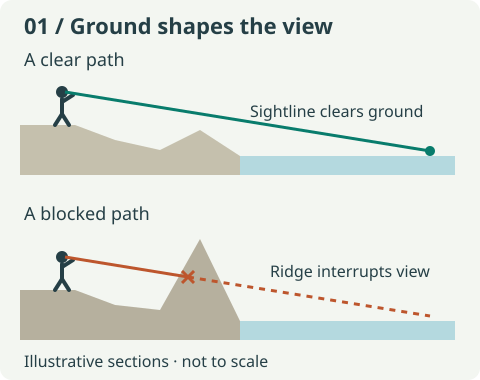
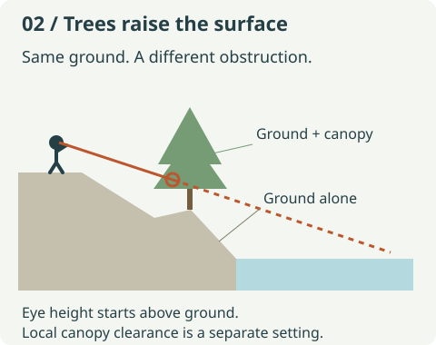
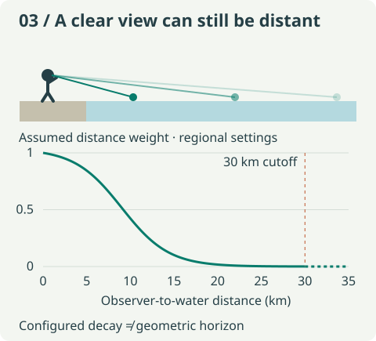

# How it works

A view across the water depends on where we stand, what lies between us and the water, and how far away we look. Viewshed modeling makes these relationships explicit.

A **viewshed** describes the locations visible from a specified viewing position under a set of
assumptions. This toolkit extends that idea to areas: it evaluates many modeled sightlines and
summarizes their support between a **source area**, containing viewing positions, and a **target
area**, containing water. Terrain, vegetation and distance each contribute to the result.

The resulting weights describe **static physical viewing support**. They help answer where
viewing is more or less supported by the modeled landscape. Whether someone is present, whether
an animal passes through, and whether an encounter is noticed and reported are separate questions.

## Sightlines through terrain and vegetation

Imagine a person standing on a coastal headland. Water directly offshore may lie in clear view,
while a ridge hides another part of the coast. Moving a short distance inland can introduce trees
between the observer and the same water. Visibility is therefore a relationship between a viewing
position and a target, rather than a single property of either location.

<figure><figcaption>A sightline connects an observer's eye to a target above the water. Intervening terrain can block one path while leaving another clear.</figcaption></figure>

<figure><figcaption>A path that clears bare ground may intersect the tree canopy. Comparing the same positions on both surfaces isolates the modeled effect of vegetation.</figcaption></figure>

For land sources, the toolkit represents the landscape using a grid of ground elevations and a
second surface formed by adding canopy height. It evaluates sightlines on both surfaces, using
specified observer and target heights. Earth's curvature and an assumed atmospheric-refraction
correction also affect the calculation. A configured clearance around each observer represents
an opening in the canopy; it is an assumption about the viewing position, not evidence that a
clearing exists there.

These diagrams are schematic. Real terrain and canopy grids have a finite resolution and a date
of observation. Small openings, recent tree growth and obstacles absent from those surfaces may
therefore be missed. A clear modeled path is evidence about that path under the stated assumptions,
not a guarantee of an unobstructed view from every nearby position.

## Distance and the strength of viewing support {#distance}

A clear sightline establishes geometric visibility. The model also applies a **distance weight**
so that otherwise comparable paths contribute less as their length increases. This is an explicit
modeling choice: the curve describes assumed attenuation of viewing support, rather than an
empirically measured probability of detecting an animal.

<figure class="explain-distance"><figcaption>An illustrative logistic curve with midpoint parameter 9 km, slope parameter 2.7 km and a 30 km cutoff. The view is schematic; the curve is calculated from these settings.</figcaption></figure>

One available choice is a normalized logistic curve. For nonnegative distance within the cutoff,
its weight is:

<math xmlns="http://www.w3.org/1998/Math/MathML" display="block" aria-label="D of d equals the quantity one plus exp of negative d fifty divided by k, all divided by the quantity one plus exp of d minus d fifty divided by k">
  <mrow><mrow><mi>D</mi><mo>(</mo><mi>d</mi><mo>)</mo></mrow><mo>=</mo><mfrac>
    <mrow><mn>1</mn><mo>+</mo><mi mathvariant="normal">exp</mi><mo>(</mo><mo>−</mo><msub><mi>d</mi><mn>50</mn></msub><mo>/</mo><mi>k</mi><mo>)</mo></mrow>
    <mrow><mn>1</mn><mo>+</mo><mi mathvariant="normal">exp</mi><mo>(</mo><mo>(</mo><mi>d</mi><mo>−</mo><msub><mi>d</mi><mn>50</mn></msub><mo>)</mo><mo>/</mo><mi>k</mi><mo>)</mo></mrow>
  </mfrac></mrow>
</math>

Here, *d* is distance in kilometres, *d*₅₀ sets the midpoint of the unnormalized curve, and *k*
controls how gradually it declines. Both parameters are positive distances in kilometres;
“exp” denotes the exponential function. Normalization sets the weight at zero distance to one.
Beyond the configured cutoff, the weight is zero. Exponential and piecewise curves are also
available; the choice and its parameters should be recorded with the results.

For the illustrated settings, the weight is approximately **0.84 at 5 km**, **0.42 at 10 km** and
**0.017 at 20 km**. Because the curve is normalized, its weight at the 9 km midpoint parameter is
about 0.518. The 30 km cutoff bounds the calculation; it is distinct from the geometric horizon,
which depends on observer height, target height and curvature/refraction assumptions.

The curve has not been calibrated here to animal size, sea state, optical equipment or observer
skill. Changing it changes the weighted scores, even when the underlying sightlines stay the same.

## From individual sightlines to areas

The toolkit groups locations into geographic grid cells using **H3**, a hierarchical spatial
index. Within each land source, it places repeatable observer samples in the land portion of the
cell. Each observer is evaluated against the target's water pixels, and the contributions are
aggregated using the recorded observer count and target-water population.

Every eligible observer–water combination contributes to that average. A clear path contributes
its distance weight; a blocked or out-of-range path contributes zero. For example, if one observer
can see 20 of 100 equally represented water pixels, the other 80 still count in the denominator.
Averaging only the visible pixels would exaggerate the area's support.

This distinction matters when reading a map. A source cell represents multiple sampled positions,
and a target cell represents an area of water. A high score does not mean every position has the
same view. Likewise, an average across observers differs from the area visible to **at least one**
observer. The recorded aggregation method determines which question a result answers.

Water sources use a separate model: sampled water positions, opaque mapped land and a geometric
horizon test. Canopy is not applicable to that source role. Land and water results retain their
separate identities because their viewing assumptions and sampling populations differ.

## Combining the components

The **terrain weight**, denoted *T*, averages bare-earth sightline contributions with distance
attenuation already included. The **vegetation factor**, *V*, expresses how much of that support
remains when the matched canopy surface is considered. Their product is the combined static
weight, *W*:

<math xmlns="http://www.w3.org/1998/Math/MathML" display="block" aria-label="Combined weight W equals terrain weight T times vegetation factor V">
  <mi>W</mi><mo>=</mo><mi>T</mi><mo>×</mo><mi>V</mi>
</math>

For a hypothetical source–target pair, a terrain weight of 0.50 and a vegetation factor of 0.90
produce:

<math xmlns="http://www.w3.org/1998/Math/MathML" display="block" aria-label="W equals 0.50 times 0.90 equals 0.45">
  <mi>W</mi><mo>=</mo><mn>0.50</mn><mo>×</mo><mn>0.90</mn><mo>=</mo><mn>0.45</mn>
</math>

Here, vegetation retains 90% of the distance-weighted baseline support. The combined value of
0.45 is a dimensionless index, **not a 45% chance of seeing an animal**, nor necessarily the
fraction of water visible. The canopy comparison is capped so vegetation cannot improve the
bare-earth baseline. When that baseline is zero, the vegetation factor is recorded as a neutral
one and the combined score remains zero; this does not establish that the area is free of trees.

A separate distance diagnostic evaluates the curve between the source and target cell centers.
It helps interpret separation, but it is **not multiplied into the combined score**: distance
has already been evaluated along the individual paths. Applying it again would count attenuation
twice.

## Reading results with their limits

A **computed zero** means no combined support remains under the model's assumptions. An
**unavailable result** means the calculation or required evidence is missing. A pair outside the
candidate set was not selected for evaluation. These states must remain distinct; blank areas on
a map should not automatically be treated as places with no view.

Comparisons also depend on source sampling, grid resolution, elevation and canopy data, and the
chosen viewing heights and distance rule. Those settings and input dates belong with the results.
Field observations can test whether the modeled geometry is useful at real viewing positions;
photographs provide context but do not by themselves validate an area-level weight.

## Why this matters {#so-what}

### Investigating observation bias

Sightings reflect both where animals occur and where people can observe and report them. Physical
viewing support can serve as one explanatory variable in a study of that observation process.
For example, researchers could compare sighting records with modeled support from known viewing
origins, while also accounting for effort, weather and environmental conditions. Testing the model
on observations withheld from fitting helps assess whether viewing support adds useful information.

A correlation alone cannot establish the cause of a reporting pattern. Presence-only records do
not supply surveyed absences, and unknown observer origins require explicit assumptions about
where viewing occurred. The toolkit supplies physical support; correcting observation bias or
estimating animal occurrence requires an additional statistical model and appropriate data.

### Comparing viewing locations

For a survey focused on a common water area, candidate land locations can be compared using the
same targets, coverage and model settings. This can help identify sites with strong support or
complementary views. A sheltered bay and an exposed headland, for instance, may cover different
parts of the intended survey area.

The shortlist still needs checks for access, viewing height and local obstructions. A geographic
source cell may include inaccessible land, while a small accessible clearing may be poorly
represented by the terrain or canopy grid.

### Designing a network of viewpoints

Combining information from several sources can reveal gaps in observation coverage. The summary
must match the research question: the highest source score describes the strongest modeled
support available for a target, while an average describes the chosen source population. Neither
is automatically the union of water visible from all viewpoints, and neither establishes how
many people actually watch from those locations.

For exact numerical definitions, sampling denominators and missing-data policies, consult the
[scientific methodology](../scientific-methodology.md). The
[output reference](../products/artifacts.md) connects these concepts to the published fields.

## See how this works in action

The case studies follow the same sequence from study area through distance, terrain and vegetation
to the combined result, with photographs to help connect the maps to views from the shore.

- [Lime Kiln: an open coastal setting](../examples.md)
- [Everett: a port and urban waterfront](../examples-everett.md)
- [Larrabee woods: an inland, wooded source area](../examples-larrabee.md)
- [Putting it all together: regional support across land sources](../examples-region.md)

